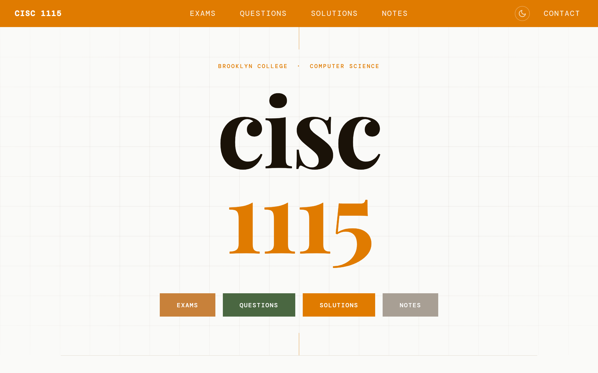
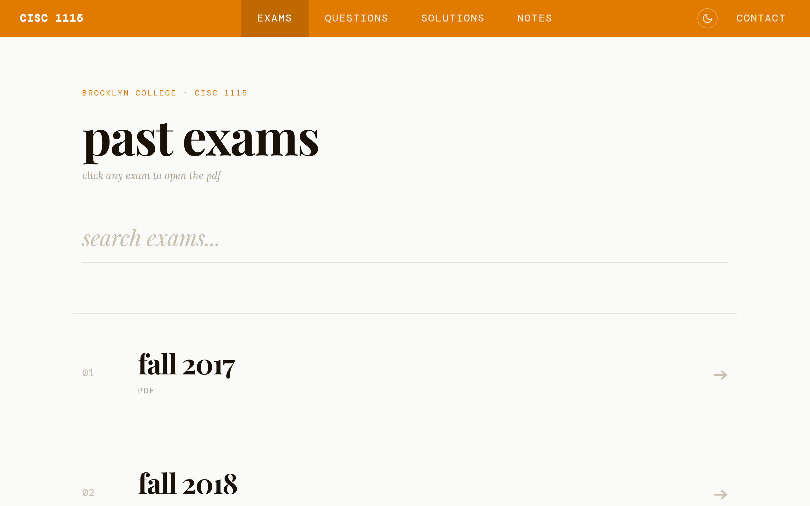
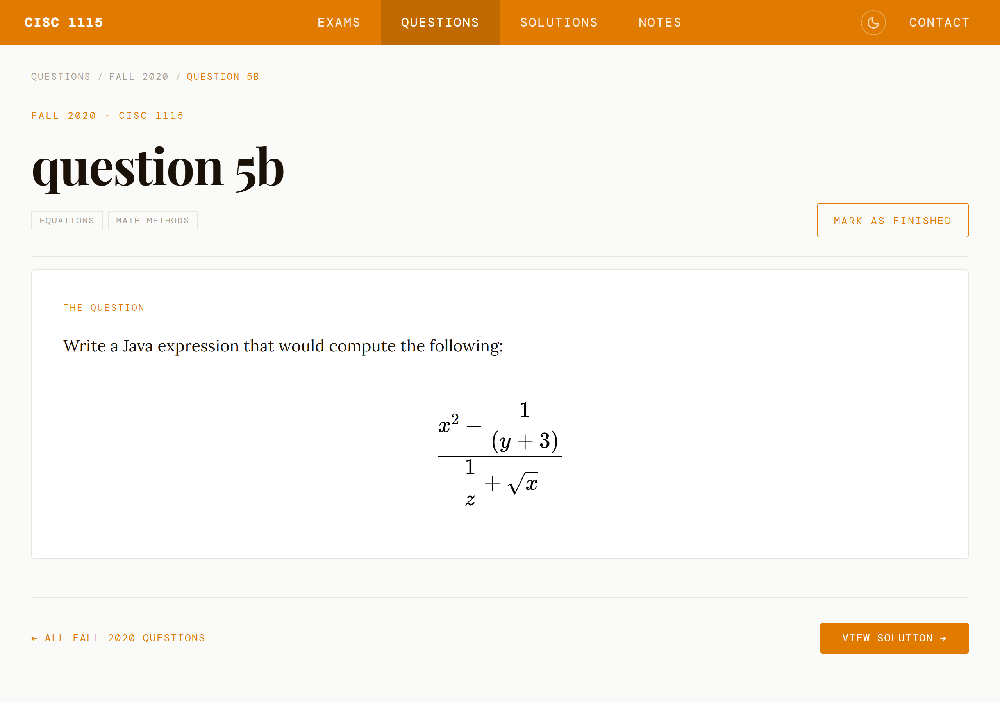
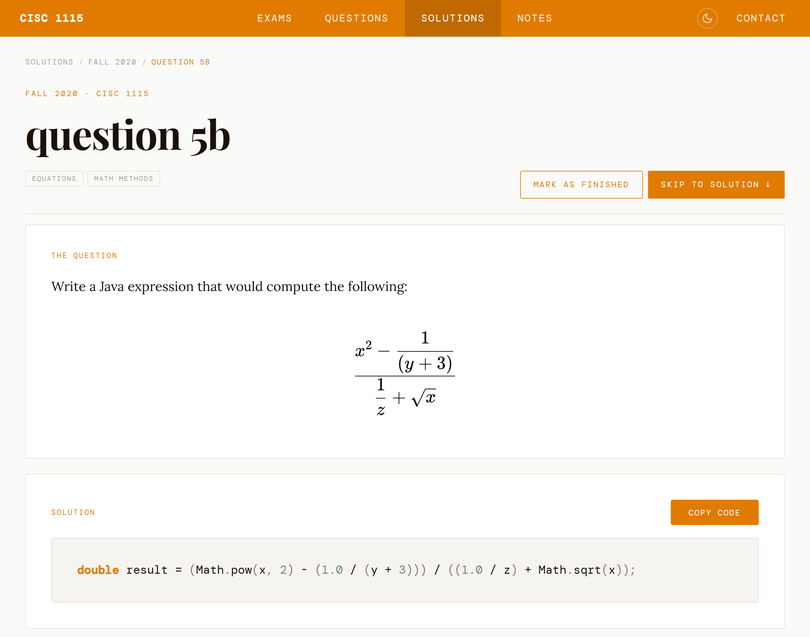
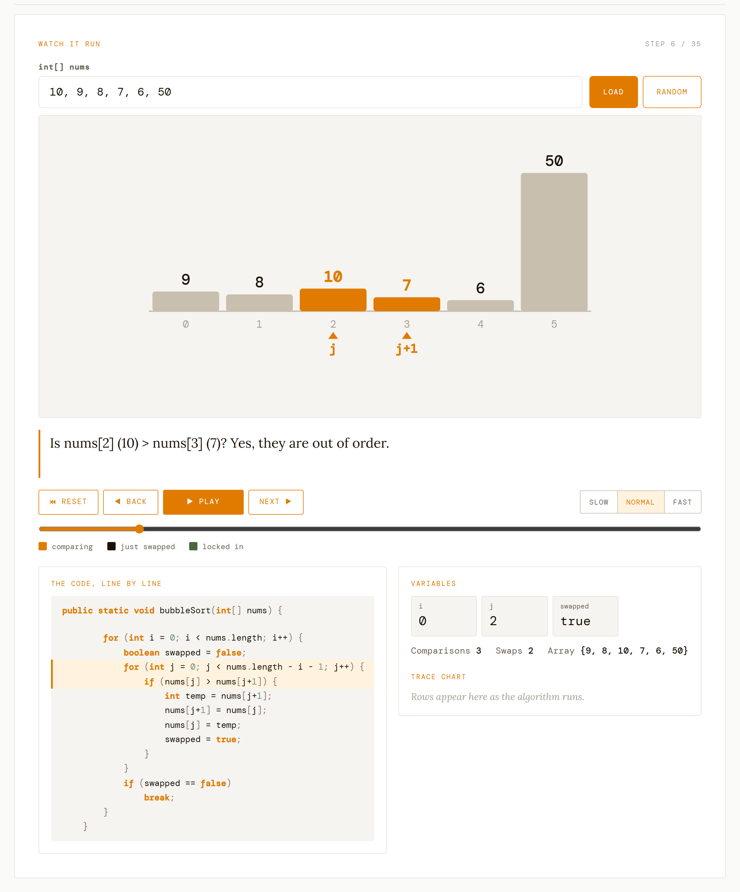
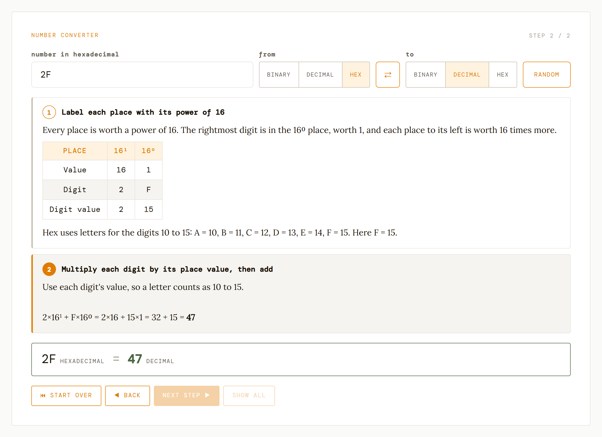

# CISC 1115 Learning Platform

Study site for Brooklyn College CISC 1115 students: past exam PDFs, extracted exam questions, worked solutions, and topic notes.

Live at https://cisc-1115.vercel.app/

I built this platform because I noticed a gap between what students know and what they are expected to know on the exams. The questions come straight from real past exams.



## What's on the site

### Exams

The original exam PDFs from fall 2017, fall 2018, fall 2020, spring 2021, and spring 2023. Click any exam to open the PDF.



### Questions and solutions

Every exam question is typed out on its own page, with code, charts, and equations formatted so they are easy to read. Try the question first, then open the solution. Each solution shows the answer, with Java code commented the way the exams require, and an explanation of how to get there.

You can mark a question as finished. Progress is saved in your browser, and a semester gets a checkmark once all of its questions are done.





### Notes

Notes cover searching, sorting, and number systems.

The searching and sorting notes have an algorithm visualizer. It runs binary search, linear search, bubble sort, or selection sort one step at a time on any array you type in. It highlights the line of Java being run, shows the variables, and builds the trace chart as it goes.



The number systems notes have a number converter. It converts between binary, decimal, and hexadecimal and shows the work step by step, using the same tables as the exam solutions.



The exam, question, solution, and note lists can all be searched, and the whole site has a dark mode.

## Develop

```bash
npm install
npm run dev      # local dev server
npm run check    # lint + tests + production build; run before committing
```

Other scripts: `npm run lint`, `npm run test`, `npm run typecheck`, `npm run build`, `npm run preview`.

## How it is built

React 19, React Router 7, TypeScript, and Vite, deployed as a static site on Vercel. There is no backend: all content is TypeScript data in `src/data`, and "finished question" progress is kept in the browser's `localStorage`.

[ARCHITECTURE.md](ARCHITECTURE.md) explains how the code is organized and how to add exams, questions, and notes.
